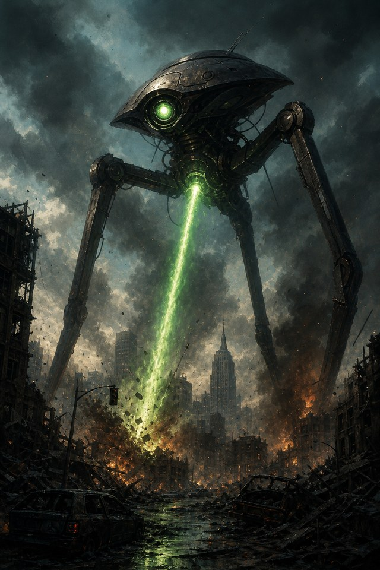
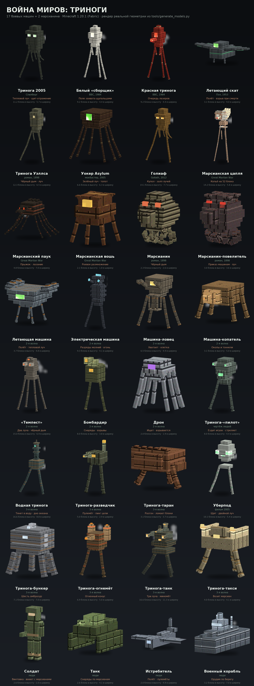

# Война миров: Триноги — War of the Worlds: Tripods

Мод для **Minecraft 1.20.1 (Fabric)**, который добавляет **17 боевых машин марсиан**: 10 треног из
всех экранизаций «Войны миров» — от романа Уэллса 1898 года до фильма Спилберга 2005-го, сериала BBC
и докудрамы *The Great Martian War* — и **7 машин второй волны**, которые уже не треноги: летающая
машина, электрическая, машина-ловец с клеткой, копатель, «Темпест», бомбардир и дрон. Плюс
**2 марсианина** и человеческая тринога с кабиной, собранная по чертежу.
У каждой машины **своя внешность, свои статы и своя особая способность.**

В комплекте: **17 боевых машин + 2 марсианина**, шесть «кирпичиков» ИИ для способностей,
собственные синтезированные звуки (сирена триног, тепловой луч, тяжёлый шаг), предмет-тепловой
луч, сплав марсиан и блоки из него, крафтящаяся **капсула вторжения**, три **структуры** из
марсианского сплава, падающие с неба цилиндры, красные корни, яйца призыва, естественный спавн и
локализация на русский и английский.

**Версия игры: Minecraft 1.20.1, Fabric Loader 0.15+, Java 17.**
Готовый `.jar` лежит в [Releases](../../releases) — скачайте `wotw-tripods-1.2.0.jar` и положите
его вместе с [Fabric API](https://modrinth.com/mod/fabric-api) в папку `mods`.
Что нового — в [CHANGELOG.md](CHANGELOG.md).



---

## Содержание

- [Все виды и их способности](#все-виды-и-их-способности)
- [Как они выглядят](#как-они-выглядят)
- [Начало войны: капсулы и структуры](#начало-войны-капсулы-и-структуры)
- [Оружие и предметы](#оружие-и-предметы)
- [Как собрать мод](#как-собрать-мод)
- [Как установить](#как-установить)
- [Как играть](#как-играть)
- [Настройки (system properties)](#настройки-system-properties)
- [Структура проекта](#структура-проекта)
- [Как добавить свою триногу](#как-добавить-свою-триногу)
- [Текстуры и звуки](#текстуры-и-звуки)
- [Технические заметки и ограничения](#технические-заметки-и-ограничения)

---

## Все виды и их способности

| # | Существо | Источник | Высота | HP / броня | Особая способность |
|---|----------|----------|--------|-----------|--------------------|
| 1 | Тринога 2005 (`tripod_2005`) | фильм Спилберга, 2005 | 11.2 блока | 220 / 12 | **Тепловой луч** (медленный, широкий, поджигает) + **энергощит**: раз в 12 с поднимает щит на 4 с, который **отражает снаряды** + **захват щупальцами** — удары подкидывают жертву левитацией |
| 2 | Белая тринога (`bbc_white_tripod`) | сериал BBC «The Tripods», 1984 | 9.2 блока | 130 / 8 | **Поле захвата**: всё живое в радиусе 12 блоков притягивается к машине и поднимается в воздух (левитация + замедление). Она не стреляет — она **собирает** людей |
| 3 | Красная тринога (`bbc_red_tripod`) | сериал BBC «The Tripods», 1984 | 9.2 блока | 150 / 10 | **Лазерная очередь**: три быстрых красных луча подряд, каждый пробивает цели и поджигает |
| 4 | Летающий манта (`flying_manta`) | фильм Джорджа Пэла, 1953 | 3.1 блока (9.0 в размахе крыльев) | 180 / 6 | **Полёт**: не касается земли, кружит над жертвой и бьёт тепловым лучом сверху. При смерти **падает и взрывается** |
| 5 | Тринога Уэллса (`book_tripod`) | роман Г. Уэллса, 1898 | 12.3 блока | 170 / 6 | **Чёрный дым**: запускает облако с ядом, слепотой и тьмой. Плюс короткий, но злой тепловой луч |
| 6 | Ходун Asylum (`asylum_walker`) | War of the Worlds (The Asylum), 2005 | 6.6 блока | 260 / 16 | **Зелёный тепловой луч** из единственного глаза + **удар по земле**: топот на 8 блоков вокруг. Шесть ног, широкий шипастый корпус |
| 7 | Тринога «Голиаф» (`goliath_tripod`) | «War of the Worlds: Goliath», 2012 | 14.1 блока | 320 / 20 | **Тепловой залп** (3 луча подряд) + **купол щита** на 6 с, который отражает снаряды и **чинит корпус** на 3 HP в секунду |
| 8 | Марсианская цапля (`martian_heron`) | The Great Martian War 1913–1917 | 14.2 блока | 150 / 4 | **Копейный луч** — самая дальняя атака в моде (52 блока), большой урон, долгий откат. Три ноги-ходули, два капюшона: передний — открытая кабина с марсианином-пилотом и двумя тепловыми пушками под подбородком, задний — бак с энергией; по три гребня сзади каждого капюшона |
| 9 | Марсианский паук (`martian_spider`) | The Great Martian War 1913–1917 | 4.8 блока | 75 / 2 | **Лазание по стенам** + **прыжок-бросок** к цели в пределах 12 блоков. Приземистый: восемь коротких ног, стреловидная голова и четыре тонких щупальца-лезвия, энергопушек нет — только скорость и бритвы |
| 10 | Марсианская вошь (`martian_louse`) | The Great Martian War 1913–1917 | 2.1 блока | 18 / 0 | **Роение**: каждые 15 секунд рядом появляется новая вошь (до 7 в стае). Укус травит ядом |
| 11 | **Марсианин** (`martian`) | роман Г. Уэллса, 1898 | 2.3 блока | 30 / — | **Чёрный дым**: плюётся облаком слепоты и яда с 12 блоков. Сам по себе хилый, но их приходит по двое-трое |
| 12 | **Марсианин-повелитель** (`martian_master`) | роман Г. Уэллса, 1898 | 3.0 блока | 70 / 8 | **Приказ**: даёт всем триногам и марсианам в радиусе 24 блоков **Силу и Скорость** на 15 с, и сам бьёт ручным тепловым лучом |
| 13 | **Летающая машина** (`flying_machine`) | 2-я волна марсиан | 3.8 блока (4.8 в ширину) | 190 / 8 | **Полёт**: никогда не касается земли, кружит над жертвой и бьёт тепловым лучом сверху |
| 14 | **Электрическая машина** (`electric_machine`) | 2-я волна марсиан | 9.4 блока | 170 / 8 | **Заряд молнии**: швыряет по дуге шар электричества — небольшой взрыв, огонь и искры. Теплового луча нет |
| 15 | **Машина-ловец** (`handling_machine`) | 2-я волна марсиан | 6.5 блока | 240 / 14 | **Клетка**: руками хватает игрока и сажает в клетку под корпусом — 5 HP каждые 2 секунды. Пока игрок в клетке, **другие машины его не видят и не стреляют**; через 20 секунд пленник вырывается (или раньше, если машину разбить). Умер в клетке — на месте смерти вырастают красные корни |
| 16 | **Машина-копатель** (`digging_machine`) | 2-я волна марсиан | 3.1 блока | 210 / 14 | **Тоннели**: бур прогрызает коридор в земле впереди себя, а если цель спряталась под землёй — копает вниз. Оставляет за собой окопы |
| 17 | **«Темпест»** (`tempest`) | 2-я волна марсиан | 15.0 блока | 300 / 16 | Четыре сильные лапы, **две тепловые пушки** (стреляют по очереди) и **чёрный дым** из труб на спине |
| 18 | **Бомбардир** (`bombarding_machine`) | 2-я волна марсиан | 8.0 блока | 140 / 6 | Две ноги и гигантский миномёт сверху: снаряды летят по дуге и рвутся как ТНТ. Лучей нет — только навесной огонь |
| 19 | **Дрон** (`drone`) | 2-я волна марсиан | 2.0 блока | 26 / — | Восемь ног, серый корпус, один фиолетовый глаз. Оружия нет: ищет игрока или жителя, подходит и **взрывается** |
| 20 | **Тринога с экипажем** (`pilot_tripod`) | чертёж людей | 8.0 блока | 160 / 12 | **Ездовая**: ставите блок-чертёж — сверху собирается тринога. ПКМ — сесть, WASD — ехать, удар по мобу — выстрел тепловым лучом. Мобы могут её разбить |

Высота в таблице — реальная высота модели в блоках: модели нарисованы в натуральную величину
(16 пикселей = 1 блок), и хитбокс каждой машины совпадает с её силуэтом.

Дополнительно у всех триног: иммунитет к огню, урону от падения и отбрасыванию, огромный шаг
(2.5 блока), собственная синтезированная сирена и выпадение **марсианского сплава**.
Марсиане, в отличие от своих машин, — обычная плоть: они горят, тонут, получают отбрасывание и
урон от падения. Зато их можно встретить ночью в пустыне, и они приводят с собой машины.

**Марсианской вши больше нет в естественном спавне.** Она появляется только из капсул и в
марсианских структурах, поэтому пещеры и ночные равнины снова тихие.

Типы урона/визуал: каждый луч — это настоящий снаряд (`BeamEntity`) со своей скоростью, дальностью,
радиусом поражения, цветом, частицами и поджигающим эффектом.

---

## Как они выглядят



Это не рисунок и не промо-арт: картинка отрисована по **настоящей геометрии** моделей и настоящим
текстурам. Геометрия живёт в `tools/generate_models.py` — из неё генерируются и Java-модели для
игры (`client/model/TripodModels.java`, `MartianModels.java`), и этот рендер, поэтому превью не
может разойтись с тем, что вы увидите в игре. Рендер учитывает UV-развёртку коробок, освещение
двумя источниками и «полную яркость» глаз.

Отдельные рендеры на прозрачном фоне лежат в `docs/models/<id>.png` — их удобно вставлять в вики
или страницу мода.

```bash
python3 tools/preview_models.py    # нужны Pillow и numpy → пересоберёт docs/models.png
```

Два пояснения к картинке: глаза и линзы в игре рисуются слоем `RenderLayer.getEyes` и всегда
светятся в темноте — здесь они тоже отрисованы «на полную яркость»; анимация (шаги, покачивание
щупалец, взмахи крыльев) в статичном рендере, конечно, не видна.

---

## Начало войны: капсулы и структуры

### Первая капсула

Через шесть секунд после того, как в мире появляется первый игрок, рядом (примерно в 22 блоках)
с неба падает **гигантский цилиндр-капсула**. Порядок событий:

1. в чате появляется предупреждение «Небо прорезает воющий свет — что-то падает!»;
2. капсула падает с высоты 70 блоков, выбивает воронку и садится в неё;
3. из неё бьёт **тепловой луч радиусом 12 блоков** — всё живое в этом радиусе сгорает;
4. из капсулы выходят **четыре марсианина** (иногда один из них — повелитель);
5. следом выходят **три случайные триноги**; у 65 % капсул они несут «семена» и оставляют за
   собой **марсианские красные корни**;
6. в чате звучит «Война миров началась. Марсиане пришли.»

Дальше **каждые семь минут** такая же капсула падает рядом со случайным игроком — с новой
командой марсиан и тремя новыми машинами.

Всё это отключается одной настройкой: `-Dwotw.invasionEventsDisabled=true`.

### Шесть структур марсиан

| Структура | Что это | Кто внутри |
|-----------|---------|------------|
| `landing_site` | стоящая капсула с люком, гребнями и кольцом выжженных плит вокруг | 3 марсианина и вошь |
| `hatchery` | капсула, лежащая на боку: длинная труба с двумя лазами, рёбрами и «гнездом» из корней | 3 марсианина и 2 вши |
| `spire` | башня-форпост на трёх ногах со светящимся ядром и огородом из корней | 3 марсианина, повелитель и вошь |
| `complex` | **комплекс**: белые блоки сплава и марсианское стекло, внутренний зал, антенна; внутри сундук с **чертежом триноги** | 3 марсианина, повелитель, 2 вши, 2 дрона |
| `dig_site` | карьер копателя: ступенчатая воронка, крытый тоннель, машина-копатель внизу | машина-копатель, 2 марсианина, дрон |
| `beacon` | маяк-башня: белый сплав, полоса стекла, светящееся ядро | повелитель, марсианин, **«Темпест»** и дрон-часовой |

Структуры сделаны из блоков **марсианского сплава** (`martian_alloy_block`) и блока-цилиндра,
генерируются в обычных биомах Обычного мира (равнины, пустыни, саванны, тайга, леса, бэдленды,
болота) с шагом 40–64 чанка. Геометрия и worldgen-данные собираются скриптом
`python3 tools/generate_structures.py` — он пишет и `.nbt`, и JSON структуры, пула и набора.

### Капсула в руке

`martian_capsule` — крафтящийся предмет: подбрасываете, и через пару секунд рядом падает настоящая
капсула со всей командой. Рецепт — кольцо из четырёх блоков сплава вокруг глыбы светокамня:

```
 A      A = блок марсианского сплава
ABA     B = светокамень
 A
```

---

## Оружие и предметы

| Предмет | Как получить | Что делает |
|---------|--------------|------------|
| **Марсианский сплав** (`martian_alloy`) | выпадает из любой убитой триноги (1–4 шт.) | материал для крафта |
| **Тепловой излучатель** (`heat_ray_emitter`) | крафт: 6 сплава + блок редстоуна (см. рецепт ниже) | ПКМ — выстрел тепловым лучом (24 тика отката, 384 прочности) |
| **Блок марсианского сплава** (`martian_alloy_block`) | крафт: 9 сплава (и обратно) | строительный материал структур |
| **Марсианский цилиндр** (`martian_cylinder`) | творческая вкладка / `/give` | ПКМ — из цилиндра выходит **случайная тринога**. Отличный способ устроить апокалипсис на сервере |
| **Марсианская капсула** (`martian_capsule`) | крафт: 4 блока сплава + светокамень | ПКМ — вызывает падение капсулы: луч, марсиане, три триноги |
| **Белый марсианский сплав** (`white_martian_alloy`) | крафт: 2 сплава + кварц | облицовка комплексов и маяков |
| **Марсианское стекло** (`martian_glass`) | крафт: сплав + 4 стекла | прочное стекло с зелёной решёткой |
| **Кровавые корни** (`blood_roots`) | крафт: 2 красных корня + редстоун | наступил — включается **Тьма**, сошёл — проходит через 3 секунды; разбрасывают споры |
| **Чертёж триноги** (`tripod_blueprint`) | крафт: 5 белого сплава + 2 бумаги + излучатель; ещё лежит в сундуке комплекса | поставить блок — сверху собирается **тринога с экипажем** |
| **Дуговой разрядник** (`arc_rifle`) | крафт: белый сплав, сплав, блок редстоуна, палка | ПКМ — электрический заряд с огнём (22 тика отката) |
| **Сплавная пушка** (`alloy_cannon`) | крафт: 5 белого сплава + порох | ПКМ — разрывной снаряд размером с ТНТ (60 тиков отката) |
| **10 яиц призыва** | творческая вкладка «Война миров: Триноги» | призыв конкретной машины |

Рецепт излучателя (`data/wotw/recipes/heat_ray_emitter.json`):

```
A A     A = марсианский сплав
ABA     B = блок редстоуна
A A
```

---

## Как собрать мод

Нужны:

- **JDK 17** (проверьте `java -version`);
- **Gradle 8.x** или IntelliJ IDEA с поддержкой Gradle;
- интернет при первой сборке (Loom скачает Minecraft 1.20.1, Yarn и Fabric API).

```bash
# в корне проекта
gradle wrapper          # если файла gradle/wrapper/gradle-wrapper.jar ещё нет
./gradlew build         # Linux / macOS
gradlew.bat build       # Windows
```

Готовый jar появится в `build/libs/wotw-tripods-1.0.0.jar` (не `-sources`).

**Без установки JDK:** в репозитории уже настроен GitHub Actions (`.github/workflows/build.yml`).
Каждый пуш собирает мод на раннере и складывает jar в артефакты, а пуш тега `v*` публикует
релиз. Именно так собран jar в [Releases](../../releases) — значит код гарантированно компилируется
под 1.20.1.

Запуск тестового клиента без сборки jar:

```bash
./gradlew runClient
```

> Если `gradle` вообще не установлен — откройте папку в IntelliJ IDEA: она сама подхватит
> `build.gradle` и предложит использовать wrapper. Версии (`minecraft_version`, `yarn_mappings`,
> `fabric_version`, `loader_version`) лежат в `gradle.properties`.

---

## Как установить

1. Установите **Fabric Loader 0.15+** для **Minecraft 1.20.1**.
2. Положите **Fabric API** (`fabric-api-0.92.x+1.20.1.jar`) и собранный `wotw-tripods-1.0.0.jar`
   в папку `mods`.
3. Запустите игру. В творческом инвентаре появится вкладка **«Война миров: Триноги»**.

---

## Как играть

- **Яйца призыва** — самый быстрый способ посмотреть все 10 машин.
- **Естественный спавн**: триноги и марсиане появляются ночью в Обычном мире, очень редко
  (вес 1–8 против 100 у зомби). Вши — никогда: только капсулы и структуры.
  Отключить природный спавн: `-Dwotw.naturalSpawnsDisabled=true`.
- **Марсианский цилиндр** — поставьте и нажмите ПКМ: вылезет случайная тринога и разнесёт всё вокруг.
- **Совет по выживанию**: большие триноги (Голиаф, Цапля, Тринога 2005) в ближнем бою почти
  безнадёжны. Используйте укрытия, ломайте линию видимости (лучи останавливаются о блоки), а
  щиты сбиваются ближним боем — щит отражает только снаряды.
- Ворованный **тепловой излучатель** — ваше главное оружие против вшей и пауков.

---

## Настройки (system properties)

| Свойство | По умолчанию | Что делает |
|----------|--------------|------------|
| `-Dwotw.naturalSpawnsDisabled=true` | выключено | полностью убирает естественный спавн триног |
| `-Dwotw.smallTripodsOnly=true` | выключено | оставляет в спавне только паука |
| `-Dwotw.invasionEventsDisabled=true` | выключено | отключает первую капсулу и периодические падения |

Пример для `user_jvm_args.txt` (Fabric-сервер) или аргументов лаунчера:

```
-Dwotw.naturalSpawnsDisabled=true
```

---

## Структура проекта

```
src/main/java/dev/arena/wotw/
├── WotwMod.java                 точка входа, регистрация
├── WotwConfig.java              «настройки» через system properties
├── block/MartianCylinderBlock.java
├── block/RedRootBlock.java           марсианские красные корни
├── item/HeatRayEmitterItem.java
├── item/MartianCapsuleItem.java      капсула в руке
├── world/                            InvasionManager, InvasionState, CagedDeathHandler
├── registry/                    ModEntities, ModItems, ModBlocks, ModSpawns, ModSounds
├── entity/
│   ├── AbstractTripodEntity.java   общая база: щит, лучи, звуки, дроп, анимация, красные корни
│   ├── Tripod2005Entity.java       …и 9 остальных машин
│   ├── MartianEntity.java          сами марсиане: чёрный дым, приказ машинам
│   ├── CapsuleEntity.java          падающая капсула: воронка, луч, марсиане, три триноги
│   ├── FlyingMachineEntity.java    …и 6 машин второй волны
│   ├── PilotTripodEntity.java      тринога с кабиной из чертежа (ездовая)
│   ├── ai/                         цели ИИ: луч, поле захвата, топот, чёрный дым, полёт, прыжок
│   └── projectile/BeamEntity.java  тепловой луч/лазер как снаряд
└── client/
    ├── WotwClient.java          регистрация моделей и рендереров
    ├── ModModelLayers.java
    ├── render/CapsuleRenderer.java  капсула (блок-цилиндр, увеличенный втрое)
    ├── model/TripodModels.java  геометрия (генерируется из tools/generate_models.py)
    ├── model/MartianModels.java геометрия марсиан
    ├── model/GenericTripodModel.java  один универсальный риг анимации
    ├── model/BeamModel.java
    └── render/                  рендереры триног и лучей
src/main/resources/
├── fabric.mod.json
├── assets/wotw/…                текстуры, модели предметов, lang (en_us, ru_ru), sounds/, иконка
├── data/wotw/structures/*.nbt    landing_site, hatchery, spire
├── data/wotw/worldgen/…          структуры, пулы, наборы + биом-теги
└── data/wotw/…                  лут-таблицы, рецепты
tools/model_lib.py               DSL моделей + генератор Java-кода моделей
tools/generate_models.py         сами модели (10 машин + 2 марсианина)
tools/generate_textures.py       генератор всех текстур (Pillow)
tools/generate_sounds.py         генератор звуков: сирена, тепловой луч, шаг (numpy + soundfile)
tools/verify_assets.py           проверка ссылок: модели, текстуры, звуки, ключи локализации
tools/preview_models.py          рендер всех машин по коду моделей → docs/models.png
tools/generate_structures.py     3 структуры: .nbt + worldgen JSON (пул, набор, биом-теги)
```

---

## Как добавить свою триногу

1. Создайте класс:

```java
public class MyTripodEntity extends AbstractTripodEntity {
    public MyTripodEntity(EntityType<? extends MyTripodEntity> type, World world) {
        super(type, world);
    }

    public static DefaultAttributeContainer.Builder createAttributes() {
        return tripodAttributes(200.0D, 0.25D, 15.0D, 10.0D, 5.0D, 1.0D, 48.0D);
    }

    @Override
    protected void addExtraGoals() {
        this.goalSelector.add(2, new BeamAttackGoal(this, BeamKind.LANCE, 12.0F, 48.0D, 30, 120));
    }
}
```

2. Зарегистрируйте тип в `ModEntities` через `tripod("my_tripod", …)` и атрибуты в
   `registerAttributes()`.
3. Добавьте яйцо призыва в `ModItems`.
4. Нарисуйте модель в `tools/generate_models.py` (части `leg*`, `wing*`, `arm*`, `head`, `body` —
   анимация подхватится автоматически), запустите `python3 tools/generate_models.py` и
   `python3 tools/preview_models.py`, посмотрите на результат и зарегистрируйте слой+рендерер
   в `WotwClient`.
5. Положите текстуру в `assets/wotw/textures/entity/my_tripod.png` (128×128) — или добавьте
   палитру в `tools/generate_textures.py` и сгенерируйте её.

Готовые «кирпичики» способностей: `BeamAttackGoal`, `CaptureFieldGoal`, `StompGoal`,
`BlackSmokeGoal`, `HoverGoal`, `PounceGoal` — они настраиваются параметрами.

---

## Текстуры и звуки

Все текстуры (10 корпусов, 4 луча, предметы, блок) сгенерированы кодом:

```bash
python3 tools/generate_textures.py    # нужен Pillow
python3 tools/generate_sounds.py       # нужны numpy и soundfile
python3 tools/verify_assets.py         # проверяет, что все ссылки на файлы живые
```

Палитры каждой машины лежат в начале скрипта в словаре `PALETTES` — можно менять цвет корпуса и
цвет «глаза» и перегенерировать за секунду. Светящаяся область текстуры находится в квадрате
`(96,96)–(128,128)`: её сэмплируют все детали-«линзы», поэтому глаза горят на любом корпусе.

Звуки тоже синтезированы, без единого сэмпла из фильмов: `tripod_horn.ogg` — та самая воющая
сирена (два расстроенных «духовых» голоса, вибрато, обертоны до шестой гармоники, медленный
глиссандо вниз), `heat_ray.ogg` — треск теплового луча, `tripod_step.ogg` — тяжёлый шаг с
металлическим призвуком. Все они прописаны в `assets/wotw/sounds.json` и зарегистрированы в
`ModSounds`; сирена звучит как ambient-звук триног (редко — раз в 20–45 секунд), луч — при каждом
выстреле, шаг — при движении.

---

## Технические заметки и ограничения

- Целевая платформа: **Fabric 1.20.1, Java 17**, Loom 1.6, Fabric API 0.92.x.
- Лучи — самостоятельные сущности (`BeamEntity`): они летят, пробивают существ, поджигают и
  останавливаются о первый твёрдый блок. Один тип оружия — один `BeamKind`.
- Щиты реализованы в `AbstractTripodEntity#damage`: пока щит поднят, урон от снарядов
  игнорируется (с искрами и звуком), ближний бой проходит.
- Модели строятся кодом (`TripodModels`), без Blockbench/JSON: один универсальный риг
  (`GenericTripodModel`) сам находит части по именам и анимирует 3-фазную походку для трёх ног и
  «чередующиеся» группы для 6 и 8 ног, плюс взмахи крыльев, качание щупалец и поворот головы за целью.
- **Честное предупреждение:** проект собирался в среде без JDK и без доступа к Maven-репозиториям,
  поэтому готовый `.jar` здесь не собран. Код проверен статически: синтаксис всех 34 файлов
  (парсер Java), все JSON-файлы валидны, а имена методов и сигнатуры сверены с официальными
  Yarn-мэппингами для 1.20.1 и исходниками Fabric API 1.20.1. Если при сборке всплывёт какая-то
  мелочь (обычно это несовпадение версии Fabric API или Loom) — поправьте версии в
  `gradle.properties` и пришлите текст ошибки, поправлю.

Лицензия: **MIT** (`LICENSE`).
