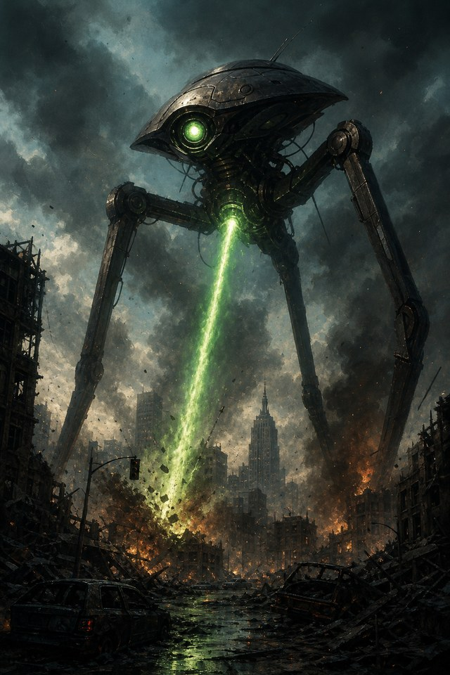
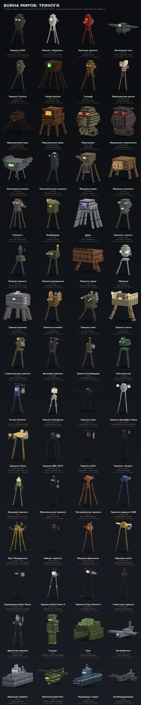

# Война миров: Триноги — War of the Worlds: Tripods

Мод для **Minecraft 1.20.1 (Forge)**, который добавляет **50 боевых машин марсиан**: 10 треног из
всех экранизаций «Войны миров» — от романа Уэллса 1898 года до фильма Спилберга 2005-го, сериала BBC
и докудрамы *The Great Martian War* — **7 машин второй волны** (летающая, электрическая,
машина-ловец с клеткой, копатель, «Темпест», бомбардир, дрон) и **8 машин третьей волны**: водная
тринога-нефтекачка, разведчик с пулемётом, таран, уберпод из фильма 2005-го, тринога-бункер с
шестью амбразурами, огнемёт, гигантская тринога-танк и тринога-такси, которая возит марсиан.
Пятая волна — инженеры и психологическое оружие: **строительная тринога** с краном-клешнёй,
**дымовая тринога**, **тринога-бомбардир**, **Марсианский Констриктор** и **Ксено-Телепат**.
Шестая волна — десять машин прямо с иллюстраций: **Кэмерон**, **Гори**, **Джефф Уэйн**, **Гобл**,
**BBC 2019**, **2021**, **«Атака»**, **Овощная**, **Мексиканская** и единственная в моде
**четырёхногая** — все десять перерисованы заново по иллюстрациям.
Седьмая волна — ещё десять машин по новым артам: **сериал 1998**, **жук Пендрагона**, **киборг
Asylum**, **медный двигатель 2012**, **паровой котёл**, **Alien Dawn**, **Alien Dawn II**,
**Scary Movie 4**, **советская книга** и единственная **двуногая** машина.
Плюс **2 марсианина**, человеческая тринога с кабиной по чертежу и **армия людей**: солдаты, танки,
истребители, военные корабли, вертолёты, подводные лодки и бомбардировщики, которые воюют с
марсианами и не трогают игрока.
У каждой машины **своя внешность, свои статы и своя особая способность.**

В комплекте: **50 боевых машин + 2 марсианина + 7 видов человеческой техники**, десять «кирпичиков» ИИ для способностей,
собственные синтезированные звуки (сирена триног, тепловой луч, тяжёлый шаг), предмет-тепловой
луч, сплав марсиан и блоки из него, крафтящаяся **капсула вторжения**, три **структуры** из
марсианского сплава, падающие с неба цилиндры, красные корни, яйца призыва, естественный спавн,
**18 структур** (марсианские комплексы и человеческие города, базы, руины, дороги и порты), новые
блоки — марсианская броня, консоли, лампы, ящики, высокая турель, кровавые лозы и заражённые
булыжник с кирпичом — и локализация на русский и английский.

**Версия игры: Minecraft 1.20.1, Forge 47.x, Java 17.**
Готовый `.jar` лежит в [Releases](../../releases) — скачайте `wotw-tripods-2.1.0.jar` и положите его
в папку `mods` (Forge-профиль 1.20.1). Никаких дополнительных библиотек не нужно: всё, что мод
требует, — это сам Forge.
Что нового — в [CHANGELOG.md](CHANGELOG.md).



---

## Содержание

- [Все виды и их способности](#все-виды-и-их-способности)
- [Как они выглядят](#как-они-выглядят)
- [Начало войны: капсулы и структуры](#начало-войны-капсулы-и-структуры)
- [Оружие и предметы](#оружие-и-предметы)
- [Как собрать мод](#как-собрать-мод)
- [Как установить](#как-установить)
- [Как играть](#как-играть)
- [Настройки (конфиг Forge)](#настройки-конфиг-forge)
- [Структура проекта](#структура-проекта)
- [Как добавить свою триногу](#как-добавить-свою-триногу)
- [Текстуры и звуки](#текстуры-и-звуки)
- [Технические заметки и ограничения](#технические-заметки-и-ограничения)

---

## Все виды и их способности

| # | Существо | Источник | Высота | HP / броня | Особая способность |
|---|----------|----------|--------|-----------|--------------------|
| 1 | Тринога 2005 (`tripod_2005`) | фильм Спилберга, 2005 | 11.2 блока | 220 / 12 | **Тепловой луч** (медленный, широкий, поджигает) + **энергощит**: раз в 12 с поднимает щит на 4 с, который **отражает снаряды** + **захват щупальцами** — удары подкидывают жертву левитацией |
| 2 | Белая тринога (`bbc_white_tripod`) | сериал BBC «The Tripods», 1984 | 9.2 блока | 130 / 8 | **Поле захвата**: всё живое в радиусе 12 блоков притягивается к машине и поднимается в воздух (левитация + замедление). Она не стреляет — она **собирает** людей |
| 3 | Красная тринога (`bbc_red_tripod`) | сериал BBC «The Tripods», 1984 | 9.2 блока | 150 / 10 | **Лазерная очередь**: три быстрых красных луча подряд, каждый пробивает цели и поджигает |
| 4 | Летающий манта (`flying_manta`) | фильм Джорджа Пэла, 1953 | 3.1 блока (9.0 в размахе крыльев) | 180 / 6 | **Полёт**: не касается земли, кружит над жертвой и бьёт тепловым лучом сверху. При смерти **падает и взрывается** |
| 5 | Тринога Уэллса (`book_tripod`) | роман Г. Уэллса, 1898 | 12.3 блока | 170 / 6 | **Чёрный дым**: запускает облако с ядом, слепотой и тьмой. Плюс короткий, но злой тепловой луч |
| 6 | Ходун Asylum (`asylum_walker`) | War of the Worlds (The Asylum), 2005 | 6.6 блока | 260 / 16 | **Зелёный тепловой луч** из единственного глаза + **удар по земле**: топот на 8 блоков вокруг. Шесть ног, широкий шипастый корпус |
| 7 | Тринога «Голиаф» (`goliath_tripod`) | «War of the Worlds: Goliath», 2012 | 14.1 блока | 320 / 20 | **Тепловой залп** (3 луча подряд) + **купол щита** на 6 с, который отражает снаряды и **чинит корпус** на 3 HP в секунду |
| 8 | Марсианская цапля (`martian_heron`) | The Great Martian War 1913–1917 | 14.2 блока | 150 / 4 | **Копейный луч** — самая дальняя атака в моде (52 блока), большой урон, долгий откат. Три ноги-ходули, два капюшона: передний — открытая кабина с марсианином-пилотом и двумя тепловыми пушками под подбородком, задний — бак с энергией; по три гребня сзади каждого капюшона |
| 9 | Марсианский паук (`martian_spider`) | The Great Martian War 1913–1917 | 4.8 блока | 75 / 2 | **Лазание по стенам** + **прыжок-бросок** к цели в пределах 12 блоков. Приземистый: восемь коротких ног, стреловидная голова и четыре тонких щупальца-лезвия, энергопушек нет — только скорость и бритвы |
| 10 | Марсианская вошь (`martian_louse`) | The Great Martian War 1913–1917 | 2.1 блока | 18 / 0 | **Роение**: каждые 15 секунд рядом появляется новая вошь (до 7 в стае). Укус травит ядом |
| 11 | **Марсианин** (`martian`) | роман Г. Уэллса, 1898 | 2.3 блока | 30 / — | **Чёрный дым**: плюётся облаком слепоты и яда с 12 блоков. Сам по себе хилый, но их приходит по двое-трое |
| 12 | **Марсианин-повелитель** (`martian_master`) | роман Г. Уэллса, 1898 | 3.0 блока | 70 / 8 | **Приказ**: даёт всем триногам и марсианам в радиусе 24 блоков **Силу и Скорость** на 15 с, и сам бьёт ручным тепловым лучом |
| 13 | **Летающая машина** (`flying_machine`) | 2-я волна марсиан | 3.8 блока (4.8 в ширину) | 190 / 8 | **Полёт**: никогда не касается земли, кружит над жертвой и бьёт тепловым лучом сверху |
| 14 | **Электрическая машина** (`electric_machine`) | 2-я волна марсиан | 9.4 блока | 170 / 8 | **Заряд молнии**: швыряет по дуге шар электричества — небольшой взрыв, огонь и искры. Теплового луча нет |
| 15 | **Машина-ловец** (`handling_machine`) | 2-я волна марсиан | 6.5 блока | 240 / 14 | **Клетка**: руками хватает игрока и сажает в клетку под корпусом — 5 HP каждые 2 секунды. Пока игрок в клетке, **другие машины его не видят и не стреляют**; через 20 секунд пленник вырывается (или раньше, если машину разбить). Умер в клетке — на месте смерти вырастают красные корни |
| 16 | **Машина-копатель** (`digging_machine`) | 2-я волна марсиан | 3.1 блока | 210 / 14 | **Тоннели**: бур прогрызает коридор в земле впереди себя, а если цель спряталась под землёй — копает вниз. Оставляет за собой окопы |
| 17 | **«Темпест»** (`tempest`) | 2-я волна марсиан | 15.0 блока | 300 / 16 | Четыре сильные лапы, **две тепловые пушки** (стреляют по очереди) и **чёрный дым** из труб на спине |
| 18 | **Бомбардир** (`bombarding_machine`) | 2-я волна марсиан | 8.0 блока | 140 / 6 | Две ноги и гигантский миномёт сверху: снаряды летят по дуге и рвутся как ТНТ. Лучей нет — только навесной огонь |
| 19 | **Дрон** (`drone`) | 2-я волна марсиан | 2.0 блока | 26 / — | Восемь ног, серый корпус, один фиолетовый глаз. Оружия нет: ищет игрока или жителя, подходит и **взрывается** |
| 20 | **Тринога с экипажем** (`pilot_tripod`) | чертёж людей | 8.0 блока | 160 / 12 | **Ездовая**: ставите блок-чертёж — сверху собирается тринога. ПКМ — сесть, WASD — ехать, удар по мобу — выстрел тепловым лучом. Мобы могут её разбить |

| 21 | **Водная тринога** (`water_tripod`) | 3-я волна марсиан | 16.6 блока | 260 / 12 | **Нефтекачка на трёх ногах**: не тонет, шагает по дну океана и **тянет** всё живое к своим опорам (отлив + замедление). Появляется только если капсула упала в воду |
| 22 | **Тринога-разведчик** (`scout_tripod`) | 3-я волна марсиан | 5.0 блока | 90 / 4 | **Пинг цели**: пулемётная очередь вместо луча. Увидев игрока, вешает на него **Свечение** и передаёт его координаты всем марсианским машинам в радиусе 48 блоков — те сразу берут его на прицел |
| 23 | **Тринога-таран** (`ram_tripod`) | 3-я волна марсиан | 3.1 блока | 180 / 8 | **Разгон**: приземистая, без оружия. Замечает игрока и на бешеной скорости несётся прямо в него, **ломая все блоки** впереди (тоннель 3×3), а на удар наносит 18 урона и подбрасывает |
| 24 | **Уберпод** (`uberpod`) | фильм Спилберга, 2005 | 10.1 блока | 280 / 14 | **Энергощит**: раз в 20 секунд поднимает купол на 8 секунд, который **отражает все снаряды** (стрелы, пули, ядра), плюс двойной тепловой луч из капюшона |
| 25 | **Тринога-бункер** (`bunker_tripod`) | 3-я волна марсиан | 7.1 блока | 320 / 16 | **Шесть амбразур**: широкий серый корпус на шести толстых ногах, все шесть окон открываются одновременно — шесть трассирующих лучей с разных точек корпуса |
| 26 | **Тринога-огнемёт** (`flamer_tripod`) | 3-я волна марсиан | 6.9 блока | 170 / 8 | **Огненный конус**: вместо теплового луча — струя горящего топлива на 7 блоков вперёд. Всё в конусе **поджигается** и получает урон; марсианские машины огонь не берёт |
| 27 | **Тринога-танк** (`tank_tripod`) | 3-я волна марсиан | 16.6 блока | 420 / 18 | Самая большая машина мода: **три тепловые пушки** (залп из трёх), **миномёт** с тремя снарядами по дуге и толстые ноги. Убить её без укрытия почти невозможно |
| 28 | **Тринога-такси** (`taxi_tripod`) | 3-я волна марсиан | 4.0 блока | 120 / 6 | **Марсианский извозчик**: без оружия, никогда не нападает. Подбирает до трёх марсиан, катает их по карте и высаживает у людских поселений или рядом с игроком |
| 29 | **Строительная тринога** (`construction_tripod`) | 5-я волна марсиан | 18.4 блока | 460 / 20 | Самая большая машина мода: три толстые длинные ноги, башня управления, два огромных кузова и **кран с длинной клешнёй**. Клешня рвёт блоки впереди и грузит их в кузова, а накопив — **строит укрытый бункер** ровно из этих блоков. Один пулемёт. **При смерти выпадает всё собранное** |
| 30 | **Дымовая тринога** (`smoke_tripod`) | 5-я волна марсиан | 15.1 блока | 250 / 12 | Ходячий котёл: вокруг постоянно висит **туман** (слепота и тьма в 13 блоках), а каждые несколько секунд — волна **чёрного дыма**, который отравляет, сушит и убивает всё живое, кроме марсиан |
| 31 | **Тринога-бомбардир** (`bomb_tripod`) | 5-я волна марсиан | 16.7 блока | 270 / 12 | **Мортира вместо луча**: навесом бросает бомбу чёрного дыма — на месте взрыва остаётся облако, которое жжёт, слепит и сушит. Достаёт за холм и на крышу |
| 32 | **Марсианский Констриктор** (`constrictor`) | 5-я волна марсиан | 13.0 блока | 300 / 16 | **Химическая пена**: два распылителя приклеивают отряд к земле (сильное замедление, нельзя копать, слабость, химический ожог), после чего **тепловая линза** добивает застрявших |
| 33 | **Ксено-Телепат** (`xeno_telepath`) | 5-я волна марсиан | 15.5 блока | 230 / 10 | Марсианин в стеклянном куполе на трёх ногах. **Телепатия**: люди рядом начинают стрелять по своим, а игрок получает тошноту и подсветку — машины видят его через стены. Есть и слабый лазер |

| 34 | **Тринога Кэмерона** (`cameron_tripod`) | иллюстрация 1950-х | 15.8 блока | 260 / 12 | Овальная стеклянная линза в золотой оправе на тонкой шее над шаровым корпусом. **Звуковая пушка**: конус давления — урон по расстоянию, жёсткий отброс и звон в голове (тошнота и замедление). Тепловой луч короткий |
| 35 | **Тринога Гори** (`gorey_tripod`) | Эдвард Гори | 15.1 блока | 150 / 6 | Чёрное блюдце с двумя жёлтыми глазами на куполе и ореолом из восьми тонких рук, которые расходятся в стороны и загибаются вверх. **Мать выводка**: каждые 12 секунд рожает из-под днища по три марсианские вши. Свой луч слабый |
| 36 | **Тринога Джеффа Уэйна** (`wayne_tripod`) | мюзикл, 1978 | 16.6 блока | 300 / 14 | Полированное серебряное яйцо с двумя зелёными глазами на макушке и двумя трубами-излучателями на выносных штангах. **Боевой барабан**: удар даёт машинам в 24 блоках силу, сопротивление и скорость, а людям — тошноту |
| 37 | **Тринога Гобла** (`goble_tripod`) | Уорвик Гобл, 1906 | 13.4 блока | 240 / 14 | Широкое клёпаное блюдце с тёмным поясом, три ферменные ноги и кран-укосина с крюком, клещами и светящейся корзиной. **Крюк**: цепляет цель, поднимает в воздух и бросает |
| 38 | **Тринога BBC 2019** (`bbc2019_tripod`) | сериал BBC, 2019 | 16.5 блока | 280 / 10 | Маленькая тёмная капсула с россыпью синих огней на двух длинных дугах-ногах. **Сначала метка, потом удар**: подсвечивает цель на три секунды, затем бьёт копейным лучом. Ходули несут её через уступы в 4 блока |
| 39 | **Тринога 2021** (`attack2021_tripod`) | фильм 2021 | 17.2 блока | 260 / 8 | Стреловидный плащ-навес над светящимся красным ядром, две ноги-раптора и хлещущий хвост. **Плащ**: дальше 18 блоков от жертвы полностью невидима, выныривает для удара |
| 40 | **Тринога «Атака»** (`attack_tripod`) | The Attack | 17.7 блока | 300 / 12 | Маленькая корона с красными глазами и занавес из десяти длинных щупалец на трёх огромных ногах. **Выпускает дронов**: до трёх штук за раз, а те сами ищут игрока и взрываются |
| 41 | **Овощная тринога** (`vegetable_tripod`) | арт | 18.5 блока | 220 / 10 | Бледный цилиндр с остроконечной шапкой, тёмными иллюминаторами и двумя руками-клешнями. **Корни**: оставляет за собой красные корни, а стоя на них — лечится на 2 HP каждые 2 секунды |
| 42 | **Мексиканская тринога** (`mexican_tripod`) | постер | 18.4 блока | 250 / 12 | Бронзовый корпус с двумя огромными жёлтыми глазами, красной лампой на шапке и двумя чёрными руками, которые заканчиваются шипастыми клешнями. **Яд и слабость** с каждого удара |
| 43 | **Четырёхногая тринога** (`four_legged_tripod`) | арт | 16.9 блока | 340 / 18 | Медное блюдце с двумя глазами, сужающейся «юбкой», четырьмя угловатыми ногами и хвостом-клешнёй — единственная не трёхногая машина. **Упор**: вкапывается (сопротивление урону) и бьёт сдвоенным топотом |
| 44 | **Тринога сериала 1998** (`series1998_tripod`) | сериал, 1998 | 16.8 блока | 240 / 11 | Широкий сине-стальной «плащ» с горящей оранжевой чашей в центре на трёх очень длинных ногах. **Пробивающий луч**: выстрел проходит насквозь и прожигает всех, кто стоит в линии за первой целью |
| 45 | **Жук Пендрагона** (`pendragon_tripod`) | Pendragon, 2005 | 15.7 блока | 280 / 13 | Кованый золотой панцирь с пластинчатой маской и хоботком, четыре загребущие ноги и шесть плетёных хлыстов. **Хлысты**: бьют по всей площади вокруг машины, отбрасывают и подтаскивают жертву под корпус |
| 46 | **Киборг-тринога** (`nextwave_cyborg_tripod`) | Asylum, 2008 | 17.8 блока | 250 / 12 | Обгорелая голова с оранжевыми глазами и расплавленным ядром на трёх ногах, обвешанных ржавым железом. **Перегрев**: раз в 10 секунд разряжается залпом по четырём ближайшим целям сразу |
| 47 | **Медный двигатель** (`true2012_tripod`) | True WOTW, 2012 | 17.7 блока | 230 / 10 | Медный моторный блок с пушкой на борту, трубами и висящими кабелями на трёх ногах с распорками. **Кислота**: на ходу оставляет лужи охлаждающей жидкости — яд и сильное замедление |
| 48 | **Паровой котёл** (`steam_tower_tripod`) | Steam Towers | 16.1 блока | 300 / 10 | Тёмный клёпаный купол с латунным поясом и двумя просверленными латунными коромыслами на тонких ногах. **Паровое облако**: слепит и замедляет людей, а марсианским машинам даёт скорость |
| 49 | **Каракатица Alien Dawn** (`alien_dawn_tripod`) | Alien Dawn, 2012 | 19.9 блока | 260 / 12 | Огромный ребристый барабан с синей полосой света во всю «лицо» на четырёх длинных ногах. **Прожектор**: метит жертву и режет её броню насквозь магическим уроном |
| 50 | **Тринога Alien Dawn II** (`alien_dawn_mk2_tripod`) | Alien Dawn II | 19.5 блока | 240 / 11 | Зеркальная «черпалка» с решётчатым лицом-динамиком и раструбом на трёх тонких ногах. **Звуковое эхо**: оглушает всё живое вокруг — замедление, тошнота и неспособность копать |
| 51 | **Тринога Scary Movie 4** (`scary_movie_tripod`) | Scary Movie 4 | 17.1 блока | 210 / 11 | Стреловидный навес с одной огромной лампой-линзой между двумя малыми и тонкие ноги с цилиндрическими ступнями. **Слепящая вспышка**: бьёт по глазам в радиусе 18 блоков слепотой и подсветкой |
| 52 | **Советская тринога** (`ussr_book_tripod`) | книга, СССР | 20.4 блока | 220 / 9 | Тёмный «колокол» с шишечкой на макушке и двумя чашками по бокам на трёх очень длинных ногах. **Глушилка**: тошнота, слабость и невозможность копать в радиусе 16 блоков |
| 53 | **Двуногая машина** (`annihilation_tripod`) | Annihilation, 2023 | 19.1 блока | 320 / 15 | Угловатый корпус с голубыми панелями, две ноги-раптора и две серповидные руки — единственная двуногая машина мода. **Прыжок-серп**: прыгает на 18 блоков и рубит обеими косами |

### Люди: армия сопротивления

| Существо | Источник | Высота | HP / броня | Что делает |
|----------|----------|--------|-----------|------------|
| **Солдат** (`human_soldier`) | люди | 2.6 блока | 24 / 4 | Винтовка: плоские пули на 5 урона. Стреляет по марсианам и триногам, **игрока не трогает** (только отвечает, если его ударить) |
| **Танк** (`human_tank`) | люди | 2.6 блока | 180 / 16 | Медленный, бронированный, бьёт снарядами по 2.2 мощности с 42 блоков |
| **Истребитель** (`human_fighter`) | люди | 2.0 блока | 70 / 6 | **Летает**, не садится, кружит над марсианскими машинами и поливает их пулемётным огнём |
| **Военный корабль** (`human_warship`) | люди | 3.3 блока | 240 / 18 | Держится воды и обстреливает берег из орудий (3.2 мощности, 48 блоков) |
| **Военный вертолёт** (`human_helicopter`) | люди | 1.7 блока (5.1 в размахе винта) | 90 / 8 | **Висит в 9 блоках** над землёй, кружит вокруг триноги и поливает её из дверных пулемётов; отходит, когда машина разворачивается на него |
| **Подводная лодка** (`human_submarine`) | люди | 2.4 блока | 150 / 12 | Идёт в трёх блоках над дном и **бьёт торпедами** (3.4 мощности) — от них остаются настоящие воронки |
| **Бомбардировщик** (`human_bomber`) | люди | 2.1 блока (7.1 в размахе крыла) | 140 / 8 | Кружит на высоте 24 блока и **роняет серию бомб** на триногу под собой; другого оружия у него нет |

Все люди ищут только марсиан: и машины, и самих марсиан. Триногу, собранную по человеческому
чертежу, они считают своей и не трогают. Марсианские машины, в свою очередь, теперь атакуют и людей.

Высота в таблице — реальная высота модели в блоках: модели нарисованы в натуральную величину
(16 пикселей = 1 блок), и хитбокс каждой машины совпадает с её силуэтом.

Дополнительно у всех триног: иммунитет к огню, урону от падения и отбрасыванию, огромный шаг
(2.5 блока), собственная синтезированная сирена и выпадение **марсианского сплава**.
Марсиане, в отличие от своих машин, — обычная плоть: они горят, тонут, получают отбрасывание и
урон от падения. Зато их можно встретить ночью в пустыне, и они приводят с собой машины.

**Марсианской вши больше нет в естественном спавне.** Она появляется только из капсул и в
марсианских структурах, поэтому пещеры и ночные равнины снова тихие.

**Размножение вшей** включается и выключается командой в чате; при создании мира оно по умолчанию
**выключено**:

```
/wotw apocalypse status      — идёт ли апокалипсис
/wotw apocalypse on          — вши снова плодятся
/wotw apocalypse off         — тишина
```

Нужен уровень оператора 2; состояние хранится в данных мира и переживает перезапуск сервера.

Типы урона/визуал: каждый луч — это настоящий снаряд (`BeamEntity`) со своей скоростью, дальностью,
радиусом поражения, цветом, частицами и поджигающим эффектом.

---

## Как они выглядят



Это не рисунок и не промо-арт: картинка отрисована по **настоящей геометрии** моделей и настоящим
текстурам. Геометрия живёт в `tools/generate_models.py` — из неё генерируются и Java-модели для
игры (`client/model/TripodModels.java`, `MartianModels.java`), и этот рендер, поэтому превью не
может разойтись с тем, что вы увидите в игре. Рендер учитывает UV-развёртку коробок, освещение
двумя источниками и «полную яркость» глаз.

Отдельные рендеры на прозрачном фоне лежат в `docs/models/<id>.png` — их удобно вставлять в вики
или страницу мода.

```bash
python3 tools/preview_models.py    # нужны Pillow и numpy → пересоберёт docs/models.png
```

Два пояснения к картинке: глаза и линзы в игре рисуются слоем `RenderLayer.getEyes` и всегда
светятся в темноте — здесь они тоже отрисованы «на полную яркость»; анимация (шаги, покачивание
щупалец, взмахи крыльев) в статичном рендере, конечно, не видна.

---

## Начало войны: капсулы и структуры

### Первая капсула

Через шесть секунд после того, как в мире появляется первый игрок, рядом (примерно в 22 блоках)
с неба падает **гигантский цилиндр-капсула**. Порядок событий:

1. в чате появляется предупреждение «Небо прорезает воющий свет — что-то падает!»;
2. капсула падает с высоты 70 блоков, выбивает воронку и садится в неё;
3. из неё бьёт **тепловой луч радиусом 12 блоков** — всё живое в этом радиусе сгорает;
4. из капсулы выходят **четыре марсианина** (иногда один из них — повелитель);
5. следом выходят **три случайные триноги**; у 65 % капсул они несут «семена» и оставляют за
   собой **марсианские красные корни**;
6. в чате звучит «Война миров началась. Марсиане пришли.»

Дальше **каждые семь минут** такая же капсула падает рядом со случайным игроком — с новой
командой марсиан и тремя новыми машинами.

Всё это отключается одной настройкой: `-Dwotw.invasionEventsDisabled=true`.

### Восемнадцать структур

| Структура | Что это | Кто внутри |
|-----------|---------|------------|
| `landing_site` | стоящая капсула с люком, гребнями и кольцом выжженных плит вокруг | 3 марсианина и вошь |
| `hatchery` | капсула, лежащая на боку: длинная труба с двумя лазами, рёбрами и «гнездом» из корней | 3 марсианина и 2 вши |
| `spire` | башня-форпост на трёх ногах со светящимся ядром и огородом из корней | 3 марсианина, повелитель и вошь |
| `complex` | **комплекс**: белые блоки сплава и марсианское стекло, внутренний зал, антенна; внутри сундук с **чертежом триноги** | 3 марсианина, повелитель, 2 вши, 2 дрона |
| `dig_site` | карьер копателя: ступенчатая воронка, крытый тоннель, машина-копатель внизу | машина-копатель, 2 марсианина, дрон |
| `beacon` | маяк-башня: белый сплав, полоса стекла, светящееся ядро | повелитель, марсианин, **«Темпест»** и дрон-часовой |
| `town` | **городок**: перекрёсток с разметкой, четыре дома с окнами и крышами, колодец, фонари, лавки | 2 солдата и 3 жителя |
| `military_base` | **военная база**: стена с воротами, казарма, оружейная с сундуком, вышка, площадка с танком | танк, 5 солдат |
| `abandoned_base` | **заброшенная база**: та же планировка, но стены пробиты, крыша рухнула, повсюду корни | разведчик, дрон и 1 марсианин |
| `ruined_houses` | **разрушенные дома**: три сгоревших дома вдоль дороги, красные лозы в комнатах | 2 марсианина, вошь, дрон |
| `road` | **дороги**: 56 блоков трассы с обочинами, разметкой, фонарём и брошенным грузовиком | 1 солдат |
| `port` | **порт**: каменный причал, деревянный пирс на сваях, склад, кран и корабль у причала. Генерируется **только у воды** (океаны, реки, пляжи) | военный корабль и 3 солдата |
| `dome_lab` | **купольная лаборатория**: белый сплав, стеклянный купол, лаборатория с консолями, ядро, турель у входа | повелитель, 2 марсианина, уберпод, разведчик |
| `root_garden` | **сад красных корней** в теплице: стеклянный ангар, грядки лозы, орошение, консоль | повелитель, 2 марсианина, вошь |
| `tripod_garage` | **гараж триног**: высокий ангар на три бокса с лампами и консолями, турель на крыше | «Темпест», таран, бункер, разведчик, марсианин |
| `signal_hill` | **сигнальный холм**: ступенчатый курган из кости и латуни, на вершине — марсианский маяк, по краю турели и пилоны, внизу мешки со спорами и ящики | Гобл, Кэмерон, Гори, марсианин |
| `goble_yard` | **латунный двор**: захваченная людьми мастерская — латунные плиты, решётчатый кран, руины стен, ящики | Гобл, Кэмерон, Уэйн, солдат, танк |
| `tripod_workshop` | **мастерская триног**: кран-балка, верстаки, стеллажи, запасные части и сундук с чертежом | таран, повелитель, марсианин, дрон |


Марсианские структуры сделаны из **марсианского сплава**, белого сплава, стекла, брони и консолей;
человеческие — из каменного кирпича, досок, брёвен и бетона. Шаг генерации у каждой свой: дороги
встречаются часто (26 чанков), города и базы — редко (86–110 чанков), порт ищется только в водных
биомах. Геометрия и worldgen-данные собираются скриптом
`python3 tools/generate_structures.py` — он пишет и `.nbt`, и JSON структуры, пула и набора.

### Капсула в руке

`martian_capsule` — крафтящийся предмет: подбрасываете, и через пару секунд рядом падает настоящая
капсула со всей командой. Рецепт — кольцо из четырёх блоков сплава вокруг глыбы светокамня:

```
 A      A = блок марсианского сплава
ABA     B = светокамень
 A
```

---

## Оружие и предметы

| Предмет | Как получить | Что делает |
|---------|--------------|------------|
| **Марсианский сплав** (`martian_alloy`) | выпадает из любой убитой триноги (1–4 шт.) | материал для крафта |
| **Тепловой излучатель** (`heat_ray_emitter`) | крафт: 6 сплава + блок редстоуна (см. рецепт ниже) | ПКМ — выстрел тепловым лучом (24 тика отката, 384 прочности) |
| **Блок марсианского сплава** (`martian_alloy_block`) | крафт: 9 сплава (и обратно) | строительный материал структур |
| **Марсианский цилиндр** (`martian_cylinder`) | творческая вкладка / `/give` | ПКМ — из цилиндра выходит **случайная тринога**. Отличный способ устроить апокалипсис на сервере |
| **Марсианская капсула** (`martian_capsule`) | крафт: 4 блока сплава + светокамень | ПКМ — вызывает падение капсулы: луч, марсиане, три триноги |
| **Белый марсианский сплав** (`white_martian_alloy`) | крафт: 2 сплава + кварц | облицовка комплексов и маяков |
| **Марсианское стекло** (`martian_glass`) | крафт: сплав + 4 стекла | прочное стекло с зелёной решёткой |
| **Кровавые корни** (`blood_roots`) | крафт: 2 красных корня + редстоун | наступил — включается **Тьма**, сошёл — проходит через 3 секунды; разбрасывают споры |
| **Чертёж триноги** (`tripod_blueprint`) | крафт: 5 белого сплава + 2 бумаги + излучатель; ещё лежит в сундуке комплекса | поставить блок — сверху собирается **тринога с экипажем** |
| **Дуговой разрядник** (`arc_rifle`) | крафт: белый сплав, сплав, блок редстоуна, палка | ПКМ — электрический заряд с огнём (22 тика отката) |
| **Сплавная пушка** (`alloy_cannon`) | крафт: 5 белого сплава + порох | ПКМ — разрывной снаряд размером с ТНТ (60 тиков отката) |
| **Марсианская броня** (`martian_hull`) | крафт: белый сплав + сплав | облицовка куполов, гаражей и мастерских |
| **Марсианская консоль** (`martian_console`) | крафт: стеклянная панель, сплав, редстоун | светящаяся техника лабораторий |
| **Марсианская лампа** (`martian_lamp`) | крафт: сплав + светокамень | холодный свет (уровень 14) |
| **Марсианская турель** (`martian_turret`) | крафт: сплав, излучатель, белый сплав | высокая турель: сама стреляет копейным лучом по игрокам в радиусе 24 блоков |
| **Ящики** (`martian_crate`, `human_crate`, `military_crate`) | крафт: сплав / доски / железо | декор и добыча в структурах |
| **Кровавые лозы** (`blood_vines`) | крафт: 4 кровавых корня | высокие лозы: Тьма при наступании, расползаются |
| **Заражённый булыжник / кирпич** (`infested_cobblestone`, `infested_bricks`) | крафт: камень + корни / кирпич + лозы | из них постепенно прорастают корни и лозы |
| **Оружейный контейнер** (`crate`) | творческая вкладка | как бочка: открывается правой кнопкой, внутри лут-таблицы `wotw:crates/martian`, `human`, `military` |
| **Пистолет** (`pistol`) | крафт: железо + порох | ПКМ — 5 урона, 10 тиков отката, плоская пуля |
| **Пулемёт** (`machine_gun`) | крафт: железо, порох, сплав | ПКМ — очередь: 4.5 урона, 4 тика отката, разброс |
| **РПГ** (`rocket_launcher`) | крафт: железо, порох, сплав | ПКМ — реактивный снаряд мощностью 4.4 (70 тиков отката) |
| **Ядерная бомба** (`nuclear_bomb`) | крафт: порох, звезда Незера, марсианский сплав | ПКМ — бросок: взрыв радиусом 12, огненный шторм и **осадки на 28 блоков** (урон по расстоянию, Wither, тошнота, голод, поджог). Откат — 240 тиков |
| **Сталь Кэмерона / латунь Гобла / кость Гори / овощная шелуха** | крафт: блок сплава + железо / медь / кости / ламинария | четыре новых металла шестой волны, из них строятся новые структуры |
| **Марсианский сигнальный маяк** (`martian_signal_beacon`) | крафт: сплав, латунь Гобла, светокамень | рабочий блок: пульсирует, лечит машины вокруг регенерацией и **раз в 30 секунд призывает новую триногу**, если рядом игрок. Ломайте его |
| **Мешок со спорами вшей** (`spore_sack`) | крафт: красные корни + сплав | рабочий блок: ПКМ — лопается и выпускает трёх вшей |
| **Яйца призыва** | творческая вкладка «Война миров: Триноги» | призыв любой машины, человека и марсианина |

Рецепт излучателя (`data/wotw/recipes/heat_ray_emitter.json`):

```
A A     A = марсианский сплав
ABA     B = блок редстоуна
A A
```

---

## Как собрать мод

Нужны:

- **JDK 17** (проверьте `java -version`);
- **Gradle 8.x** или IntelliJ IDEA с поддержкой Gradle;
- интернет при первой сборке (ForgeGradle скачает Minecraft 1.20.1, официальные мэппинги Mojang и Forge).

```bash
# в корне проекта
gradle wrapper          # если файла gradle/wrapper/gradle-wrapper.jar ещё нет
./gradlew build         # Linux / macOS
gradlew.bat build       # Windows
```

Готовый jar появится в `build/libs/wotw-tripods-1.4.0.jar` (не `-sources`).

Хотите проверить, что мод действительно загружается, — поднимите сервер прямо из проекта:

```bash
./gradlew runServer      # в run/ появится мир, в консоли — Done (…)
```

То же самое делает CI на каждый пуш, поэтому «собирается» и «работает» проверяются отдельно.

**Без установки JDK:** в репозитории уже настроен GitHub Actions (`.github/workflows/build.yml`).
Каждый пуш собирает мод на раннере и складывает jar в артефакты, а пуш тега `v*` публикует
релиз. Именно так собран jar в [Releases](../../releases) — значит код гарантированно компилируется
под 1.20.1.

Запуск тестового клиента без сборки jar:

```bash
./gradlew runClient
```

> Если `gradle` вообще не установлен — откройте папку в IntelliJ IDEA: она сама подхватит
> `build.gradle` и предложит использовать wrapper. Версии (`minecraft_version`, `forge_version`)
> лежат в `gradle.properties`.

---

## Как установить

1. Установите **Forge 47.x** для **Minecraft 1.20.1** (рекомендуется 47.2.0).
2. Положите собранный `wotw-tripods-1.4.0.jar` в папку `mods`.
3. Запустите игру. В творческом инвентаре появится вкладка **«Война миров: Триноги»**.

---

## Как играть

- **Яйца призыва** — самый быстрый способ посмотреть все 40 машин и армию людей.
- **Естественный спавн**: триноги и марсиане появляются ночью в Обычном мире, очень редко
  (вес 1–8 против 100 у зомби). Вши — никогда: только капсулы и структуры.
  Отключить природный спавн: `naturalSpawns = false` в конфиге (см. ниже).
- **Марсианский цилиндр** — поставьте и нажмите ПКМ: вылезет случайная тринога и разнесёт всё вокруг.
- **Совет по выживанию**: большие триноги (Голиаф, Цапля, Тринога 2005) в ближнем бою почти
  безнадёжны. Используйте укрытия, ломайте линию видимости (лучи останавливаются о блоки), а
  щиты сбиваются ближним боем — щит отражает только снаряды.
- Ворованный **тепловой излучатель** — ваше главное оружие против вшей и пауков.

---

## Настройки (конфиг Forge)

Файл `config/wotw-common.toml` создаётся при первом запуске (правится и в игре, и на сервере):

| Ключ | По умолчанию | Что делает |
|------|--------------|------------|
| `spawning.naturalSpawns` | `true` | естественный спавн триног в Обычном мире |
| `spawning.smallTripodsOnly` | `false` | оставляет в спавне только мелких (паук, вошь) |
| `invasion.invasionEvents` | `true` | первая капсула и периодические падения |

Старые system properties продолжают работать как значения по умолчанию (например,
`-Dwotw.naturalSpawnsDisabled=true` в аргументах лаунчера или `user_jvm_args.txt` сервера);
значения из конфига их перекрывают.

---

## Структура проекта

```
src/main/java/dev/arena/wotw/
├── WotwMod.java                 точка входа, регистрация
├── WotwConfig.java              «настройки» через system properties
├── block/MartianCylinderBlock.java
├── block/RedRootBlock.java           марсианские красные корни
├── item/HeatRayEmitterItem.java
├── item/MartianCapsuleItem.java      капсула в руке
├── world/                            InvasionManager, InvasionState, CagedDeathHandler
├── registry/                    ModEntities, ModItems, ModBlocks, ModSpawns, ModSounds
├── entity/
│   ├── AbstractTripodEntity.java   общая база: щит, лучи, звуки, дроп, анимация, красные корни
│   ├── Tripod2005Entity.java       …и 9 остальных машин
│   ├── MartianEntity.java          сами марсиане: чёрный дым, приказ машинам
│   ├── CapsuleEntity.java          падающая капсула: воронка, луч, марсиане, три триноги
│   ├── FlyingMachineEntity.java    …и 6 машин второй волны
│   ├── WaterTripodEntity.java      …и 8 машин третьей волны
│   ├── AbstractHumanCombatantEntity.java  солдат, танк, истребитель, корабль
│   ├── PilotTripodEntity.java      тринога с кабиной из чертежа (ездовая)
│   ├── ai/                         цели ИИ: луч, поле захвата, топот, чёрный дым, полёт, прыжок
│   └── projectile/BeamEntity.java  тепловой луч/лазер как снаряд
└── client/
    ├── WotwClient.java          регистрация моделей и рендереров
    ├── ModModelLayers.java
    ├── render/CapsuleRenderer.java  капсула (блок-цилиндр, увеличенный втрое)
    ├── model/TripodModels.java  геометрия (генерируется из tools/generate_models.py)
    ├── model/MartianModels.java геометрия марсиан
    ├── model/GenericTripodModel.java  один универсальный риг анимации
    ├── model/BeamModel.java
    └── render/                  рендереры триног и лучей
src/main/resources/
├── META-INF/mods.toml           описание мода для Forge
├── assets/wotw/…                текстуры, модели предметов, lang (en_us, ru_ru), sounds/, иконка
├── data/wotw/structures/*.nbt    16 структур: посадки, ульи, шпили, городки, базы, порты
├── data/wotw/worldgen/…          структуры, пулы, наборы + биом-теги
└── data/wotw/…                  лут-таблицы, рецепты
tools/model_lib.py               DSL моделей + генератор Java-кода моделей
tools/generate_models.py         сами модели (25 машин + 2 марсианина + 4 людских)
tools/generate_textures.py       генератор всех текстур (Pillow)
tools/generate_sounds.py         генератор звуков: сирена, тепловой луч, шаг (numpy + soundfile)
tools/verify_assets.py           проверка ссылок: модели, текстуры, звуки, ключи локализации
tools/preview_models.py          рендер всех машин по коду моделей → docs/models.png
tools/generate_structures.py     16 структур: .nbt + worldgen JSON (пул, набор, биом-теги)
```

---

## Как добавить свою триногу

1. Создайте класс:

```java
public class MyTripodEntity extends AbstractTripodEntity {
    public MyTripodEntity(EntityType<? extends MyTripodEntity> type, World world) {
        super(type, world);
    }

    public static DefaultAttributeContainer.Builder createAttributes() {
        return tripodAttributes(200.0D, 0.25D, 15.0D, 10.0D, 5.0D, 1.0D, 48.0D);
    }

    @Override
    protected void addExtraGoals() {
        this.goalSelector.add(2, new BeamAttackGoal(this, BeamKind.LANCE, 12.0F, 48.0D, 30, 120));
    }
}
```

2. Зарегистрируйте тип в `ModEntities` через `tripod("my_tripod", …)` и атрибуты в
   `registerAttributes()`.
3. Добавьте яйцо призыва в `ModItems`.
4. Нарисуйте модель в `tools/generate_models.py` (части `leg*`, `wing*`, `arm*`, `head`, `body` —
   анимация подхватится автоматически), запустите `python3 tools/generate_models.py` и
   `python3 tools/preview_models.py`, посмотрите на результат и зарегистрируйте слой+рендерер
   в `WotwClient`.
5. Положите текстуру в `assets/wotw/textures/entity/my_tripod.png` (128×128) — или добавьте
   палитру в `tools/generate_textures.py` и сгенерируйте её.

Готовые «кирпичики» способностей: `BeamAttackGoal`, `CaptureFieldGoal`, `StompGoal`,
`BlackSmokeGoal`, `HoverGoal`, `PounceGoal` — они настраиваются параметрами.

---

## Текстуры и звуки

Все текстуры (10 корпусов, 4 луча, предметы, блок) сгенерированы кодом:

```bash
python3 tools/generate_textures.py    # нужен Pillow
python3 tools/generate_sounds.py       # нужны numpy и soundfile
python3 tools/verify_assets.py         # проверяет, что все ссылки на файлы живые
```

Палитры каждой машины лежат в начале скрипта в словаре `PALETTES` — можно менять цвет корпуса и
цвет «глаза» и перегенерировать за секунду. Светящаяся область текстуры находится в квадрате
`(96,96)–(128,128)`: её сэмплируют все детали-«линзы», поэтому глаза горят на любом корпусе.

Звуки тоже синтезированы, без единого сэмпла из фильмов: `tripod_horn.ogg` — та самая воющая
сирена (два расстроенных «духовых» голоса, вибрато, обертоны до шестой гармоники, медленный
глиссандо вниз), `heat_ray.ogg` — треск теплового луча, `tripod_step.ogg` — тяжёлый шаг с
металлическим призвуком. Все они прописаны в `assets/wotw/sounds.json` и зарегистрированы в
`ModSounds`; сирена звучит как ambient-звук триног (редко — раз в 20–45 секунд), луч — при каждом
выстреле, шаг — при движении.

---

## Технические заметки и ограничения

- Целевая платформа: **Forge 1.20.1 (47.x), Java 17**, ForgeGradle 6, официальные мэппинги Mojang
  (`official`). Регистрация — через `DeferredRegister`, точки входа — `@Mod` и `@Mod.EventBusSubscriber`.
- Лучи — самостоятельные сущности (`BeamEntity`): они летят, пробивают существ, поджигают и
  останавливаются о первый твёрдый блок. Один тип оружия — один `BeamKind`.
- Щиты реализованы в `AbstractTripodEntity#hurt`: пока щит поднят, урон от снарядов
  игнорируется (с искрами и звуком), ближний бой проходит.
- Модели строятся кодом (`TripodModels`), без Blockbench/JSON: один универсальный риг
  (`GenericTripodModel`) сам находит части по именам и анимирует 3-фазную походку для трёх ног и
  «чередующиеся» группы для 6 и 8 ног, плюс взмахи крыльев, качание щупалец и поворот головы за целью.
- Перенос на Forge сделан скриптом `tools/port_to_forge.py`: он переводит исходники с Yarn-имён на
  официальные мэппинги Mojang (классы, методы, пакеты) и оставляет в покое только те места, где
  Forge требует своего — регистрация, события, творческая вкладка, спавн, слои моделей.
- Сборка проверяется в CI (`.github/workflows/build.yml`): раннер ставит JDK 17 и Gradle, запускает
  `gradle build`; при падении текст ошибки публикуется отдельным issue, при успехе — артефакт с jar.

Лицензия: **MIT** (`LICENSE`).
